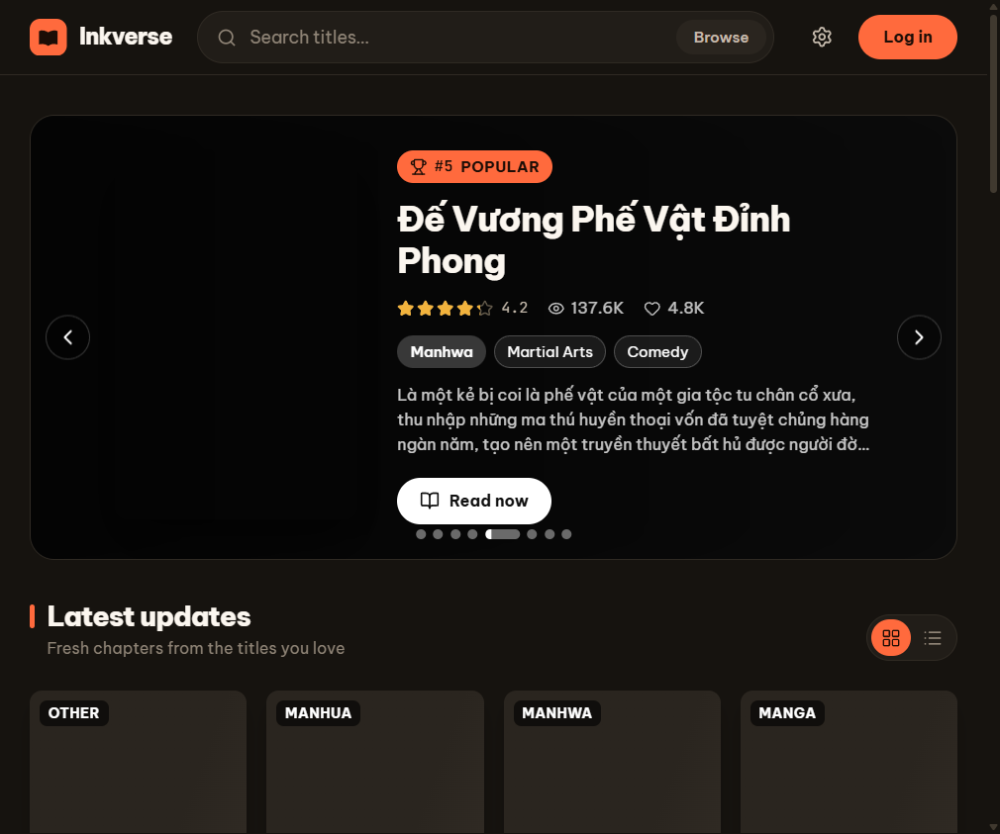
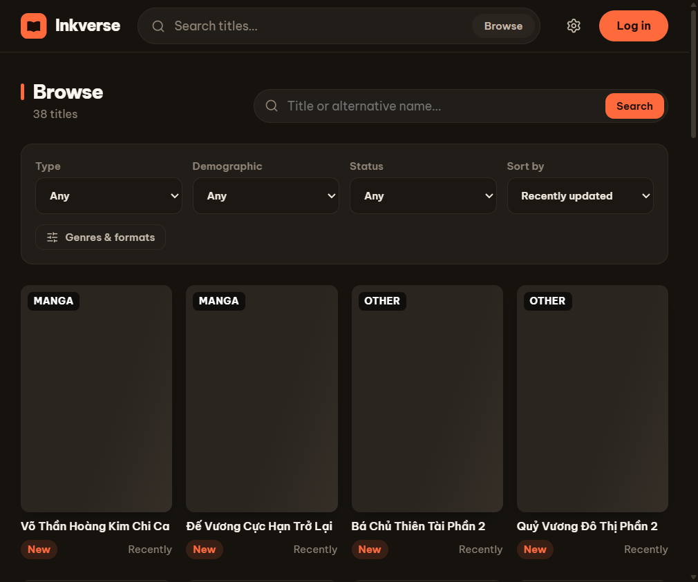
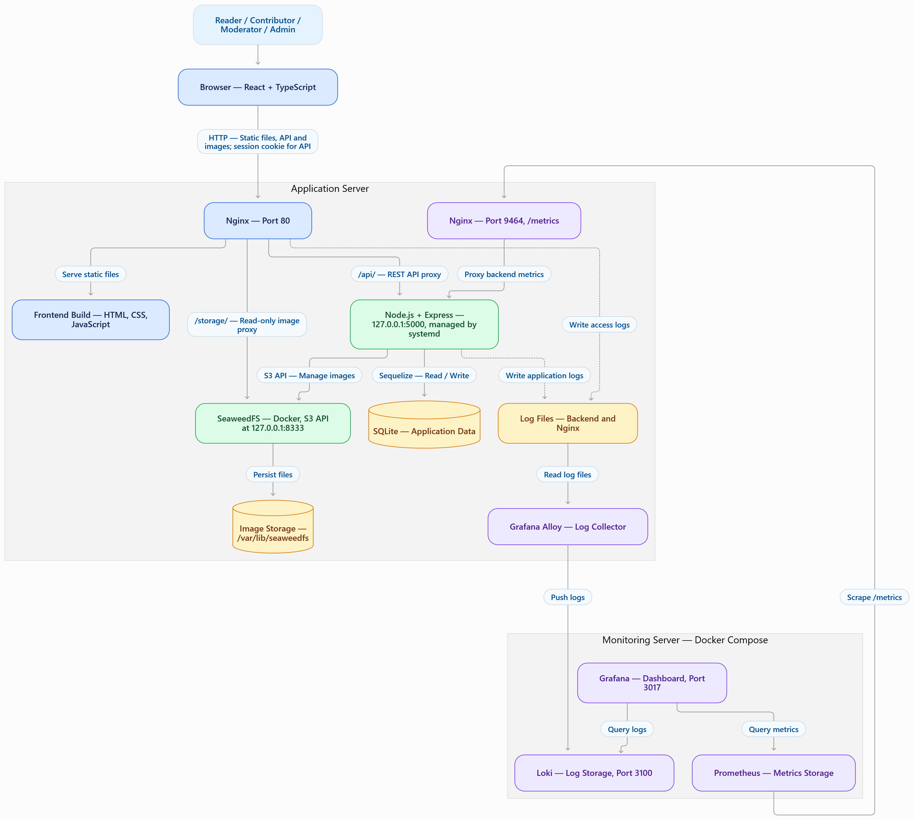
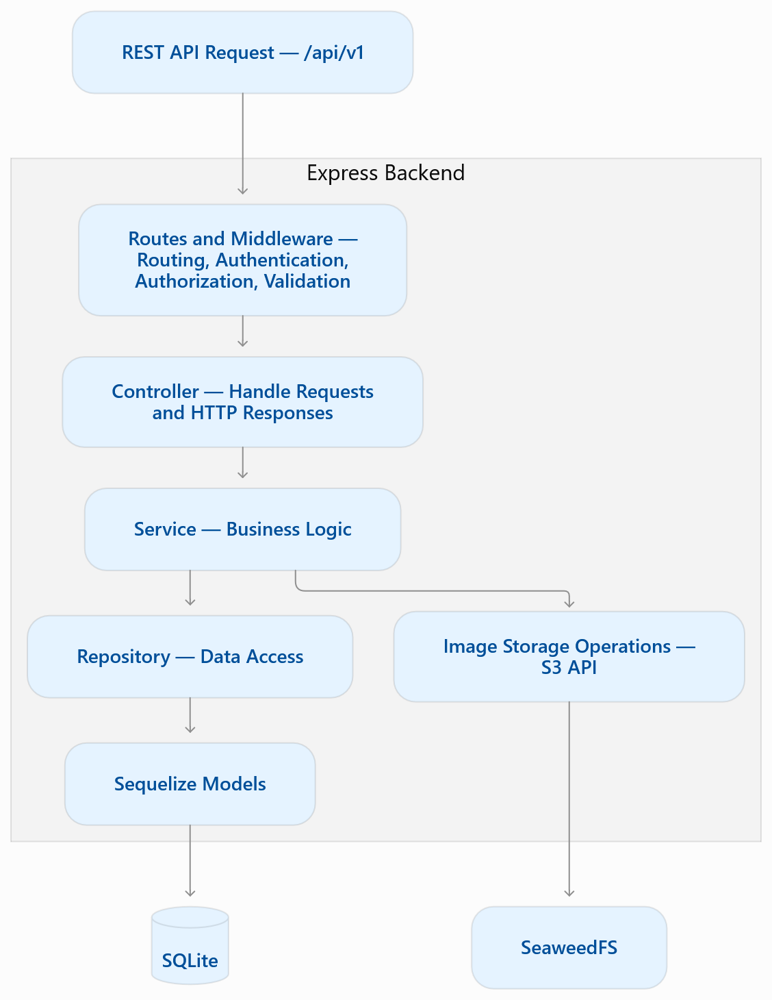

# Inkverse — A Comic Reading Platform

Inkverse is a website for discovering and reading manga, manhwa, and manhua. Readers can browse titles, read chapters, follow series, rate and discuss comics, and manage their reading history. Contributors publish through Studio, while moderators and admins manage content through dedicated consoles.

## Web interface

<p align="center">
  
  
</p>

## System overview

<p align="center">
  
</p>

| Area | Responsibility | Main technologies |
|---|---|---|
| [`frontend/`](frontend/) | Single-page web app for readers and the Studio/Admin consoles | React 19, TypeScript, Vite, React Router 7, CSS Modules |
| [`backend/`](backend/) | REST API, authentication, application logic, database, and uploaded image delivery | Node.js (ES modules), Express 4, Sequelize 6, SQLite |

## Features

- **Discover and read comics:** home page, search and filters, comic details, chapter reader, rankings, and recommendations.
- **Reader accounts:** profiles, follows, ratings, comments, reading history, and appearance preferences.
- **Studio:** contributors manage comics and chapters; moderators review submissions and reports.
- **Admin console:** manage users, content, role requests, comments, application settings, and restore new comics from ZIP backups.
- **PWA support:** the frontend includes a web app manifest and service worker. API responses are not cached.

## Request flow

- The frontend uses the versioned REST API at `/api/v1`; interactive API documentation is available at `http://<your-domain>/api/docs` behind Nginx or `http://localhost:5000/api/docs` during local backend development.
- Browser sessions use an HttpOnly cookie, which the frontend sends with API requests.
- The backend stores application data in SQLite. Local development uses `backend/storage/`; production uses self-hosted SeaweedFS (a single Docker container) for S3-compatible object storage.
- Image columns store relative object keys such as `comics/<uuid>.webp` and `chapter-images/<uuid>.jpg`, not host filesystem paths or provider-specific URLs. The frontend resolves those keys through `VITE_STORAGE_URL`; without it, `/storage/` is used.
- In production, a host-installed Nginx ([`nginx/default.conf`](nginx/default.conf)) serves the frontend build, proxies `/api/` to the backend on `127.0.0.1:5000`, and proxies read-only `/storage/` requests to the public-read SeaweedFS bucket on `127.0.0.1:8333`. SeaweedFS ports are bound to `127.0.0.1` only.

### Backend request architecture

<p align="center">
  
</p>

## Project structure

### Backend

```text
backend/
├── src/
│   ├── config/        # Database connection configuration
│   ├── controllers/   # HTTP request and response handling
│   ├── docs/          # OpenAPI specification and Swagger UI
│   ├── helpers/       # Shared application helpers
│   ├── middlewares/   # Authentication, validation, errors, and uploads
│   ├── models/        # Sequelize models and table initialization
│   ├── repositories/  # Data access
│   ├── routes/        # API endpoint definitions
│   ├── services/      # Application logic
│   └── utils/         # Shared utilities
├── data/              # Default SQLite database
├── storage/           # Local uploads and migration source/rollback copy
├── scripts/           # Sample data and recommendation evaluation
└── tests/             # API and application tests
```

Requests are organized across the route → controller → service → repository layers. `src/server.js` starts the server, and `src/app.js` configures the Express application and middleware.

### Frontend

```text
frontend/
├── src/
│   ├── pages/         # Home, Browse, MangaDetail, MangaReader, Profile, Studio, Admin, and more
│   ├── components/    # Reusable UI components
│   ├── layout/        # Application and console layouts
│   ├── features/      # Studio and Admin feature modules
│   ├── console/       # Shared console UI and utilities
│   ├── services/      # Backend API client
│   ├── context/       # Authentication, theme, and toast state
│   ├── hooks/         # Shared React hooks
│   ├── helpers/       # Utility functions
│   ├── types/         # Shared TypeScript types
│   └── assets/        # UI assets
└── public/            # Manifest, service worker, icons, and static assets
```

## Run locally

Requirements: Node.js **20.19+** or **22.12+**, and npm.

Start the backend and frontend in separate terminals:

```bash
# Terminal 1 — backend at http://localhost:5000
cd backend
npm install
npm run dev
```

```bash
# Terminal 2 — frontend at http://localhost:5173
cd frontend
npm install
npm run dev
```

On first startup, the backend creates or updates the application tables in `backend/data/comic-platform.sqlite`, but it does not create an admin account automatically. To create one, stop the backend, set the admin credentials (the `ADMIN_*` entries in `backend/.env.example` are the reference), and run the setup script in PowerShell:

```powershell
cd backend
$env:ADMIN_EMAIL = "admin@example.com"
$env:ADMIN_PASSWORD = "choose-a-strong-password"
node scripts/setupDatabase.js
```

The script asks you to type `RESET` before deleting the existing database. Pass `--yes` to confirm non-interactively. This is a destructive database reset: it creates all application tables and only the admin account, with no sample comics or users. `ADMIN_USERNAME` defaults to `admin`; `ADMIN_DISPLAY_NAME` defaults to `Administrator`. The example environment file does not create the account by itself, and no default password is provided.

## Tests and build

```bash
# Backend tests
cd backend
npm test
```

```bash
# Type-check, lint, and build the frontend
cd frontend
npm run build
npm run lint
```

## Deployment

Production is split into three independently deployable parts. The frontend, backend, and Nginx run directly on the app server (no Docker); SeaweedFS runs as a single Docker container on the same host; monitoring runs with Docker Compose on a separate server. `scripts/package-deploy.py` builds `deploy-dist/comic-app-deploy.zip` with this layout:

```text
comic-app-deploy.zip
├── app/              → /opt/comic-app on the app server
│   ├── backend/
│   ├── frontend/
│   └── default.conf  (Nginx site config)
├── object-storage/   → SeaweedFS Dockerfile + init.sh (app server)
└── monitoring/       → monitoring server (agent/ goes to the app server)
```


| Path | Server | Contents |
|---|---|---|
| `/opt/comic-app/{backend,frontend,default.conf}` | app | Source code and Nginx site config |
| `/opt/comic-app/object-storage/seaweedfs` | app | SeaweedFS Dockerfile, `init.sh`, `.env` |
| `/var/www/comic-app` | app | Frontend build (`frontend/dist`), Nginx document root |
| `/var/lib/comic-app/data` | app | SQLite database and Admin ZIP restore staging |
| `/var/lib/comic-app/storage` | app | Local image directory (`STORAGE_ROOT`) |
| `/var/log/comic-app` | app | Backend logs (`LOG_DIR`), read by the Alloy agent |
| `/var/log/nginx/comic-app.access.log` | app | Nginx JSON access log |
| `/var/lib/seaweedfs` | app | SeaweedFS data (bind-mounted to `/data`) |
| `/var/lib/alloy/data` | app | Alloy agent position files (created by the `alloy` package) |
| `/opt/comic-monitoring` | monitoring | Monitoring configuration (`monitoring/`) |
| `/var/lib/comic-monitoring/{prometheus,loki,grafana}` | monitoring | Monitoring data |

Back up `/var/lib/comic-app` and `/var/lib/seaweedfs` together; a single SeaweedFS node has no hardware redundancy.

### 1. Object storage (SeaweedFS)

[`storage/seaweedfs/init.sh`](storage/seaweedfs/init.sh) builds the image from [`storage/seaweedfs/Dockerfile`](storage/seaweedfs/Dockerfile) and starts it with `docker run` (no Compose). It binds the master (`9333`), filer (`8888`), and S3 (`8333`) ports to `127.0.0.1`, stores data in `/var/lib/seaweedfs`, creates the `comic-images` bucket, and grants anonymous read-only access to it. Re-running the script rebuilds and recreates the container without touching the data.

```bash
cd /opt/comic-app/object-storage/seaweedfs
cp .env.example .env          # strong AWS_ACCESS_KEY_ID / AWS_SECRET_ACCESS_KEY
sudo bash init.sh             # override with e.g. DATA_DIR=/mnt/data/seaweedfs
```

### 2. Backend

Requirements: Node.js **22.12+**.

```bash
sudo useradd --system --home /opt/comic-app --shell /usr/sbin/nologin comic
sudo mkdir -p /var/lib/comic-app/data /var/lib/comic-app/storage /var/log/comic-app
sudo chown -R comic:comic /var/lib/comic-app /var/log/comic-app

cd /opt/comic-app/backend
npm ci --omit=dev
cp .env.example .env          # same S3 credentials as SeaweedFS; set CLIENT_ORIGIN, APP_URL, STORAGE_PUBLIC_URL
sudo chown root:comic .env && sudo chmod 640 .env

# One-time: create tables and the admin account (destructive reset; asks you to type RESET)
sudo -u comic ADMIN_EMAIL=admin@example.com ADMIN_PASSWORD='choose-a-strong-password' \
  node --env-file=.env scripts/setupDatabase.js

sudo cp comic-app-backend.service /etc/systemd/system/
sudo systemctl daemon-reload && sudo systemctl enable --now comic-app-backend
```

The backend listens on `HOST=127.0.0.1`, so it is reachable only through Nginx.

### 3. Frontend and Nginx

```bash
cd /opt/comic-app/frontend
echo "VITE_API_ORIGIN=/" > .env
npm ci && npm run build
sudo mkdir -p /var/www/comic-app && sudo rsync -a --delete dist/ /var/www/comic-app/

sudo cp /opt/comic-app/default.conf /etc/nginx/conf.d/default.conf
sudo rm -f /etc/nginx/sites-enabled/default      # Debian/Ubuntu
sudo nginx -t && sudo systemctl reload nginx
```

Nginx also listens on `9464` for `/metrics`; add the monitoring server IP to the `allow` list in that server block and open the port in the firewall only for that IP. For HTTPS, add TLS to the main server block and set `COOKIE_SECURE=true`.

### Backend configuration

All backend settings live in `backend/.env` (loaded by systemd `EnvironmentFile`, or `node --env-file=.env` for scripts). Keep every `.env` private.

| Variable | Production value | Purpose |
|---|---|---|
| `NODE_ENV` | `production` | Runtime mode |
| `HOST`, `PORT` | `127.0.0.1`, `5000` | Listen address and port; unset `HOST` listens on all interfaces |
| `CLIENT_ORIGIN` | `http://your-domain.example` | Allowed frontend origins, separated by commas |
| `APP_URL` | `http://your-domain.example` | Frontend URL used in password-reset emails |
| `DB_PATH` | `/var/lib/comic-app/data/comic-platform.sqlite` | SQLite database path (`backend/data/...` locally) |
| `STORAGE_ROOT` | `/var/lib/comic-app/storage` | Local image directory (`backend/storage` locally) |
| `ADMIN_IMPORT_STAGING_DIR` | `/var/lib/comic-app/data/admin-import-staging` | Private staging for Admin ZIP restore |
| `LOG_DIR` | `/var/log/comic-app` | Backend log directory (`backend/logs` locally) |
| `STORAGE_DRIVER` | `s3` | `local` or `s3` |
| `STORAGE_ENDPOINT` | `http://127.0.0.1:8333` | SeaweedFS S3 API |
| `STORAGE_REGION` | `us-east-1` | S3 signing region |
| `STORAGE_BUCKET` | `comic-images` | Bucket name; keep in sync with the Nginx `/storage/` route and `init.sh` |
| `STORAGE_PUBLIC_URL` | `http://your-domain.example/storage` | Public base URL for stored images |
| `STORAGE_FORCE_PATH_STYLE` | `true` | Use path-style S3 requests |
| `AWS_ACCESS_KEY_ID`, `AWS_SECRET_ACCESS_KEY` | must match `storage/seaweedfs/.env` | S3 credentials |
| `COOKIE_SECURE`, `COOKIE_SAMESITE` | `false` over HTTP, `true` over HTTPS; `lax` | Session-cookie settings |
| `SMTP_HOST`, `SMTP_PORT`, `SMTP_USER`, `SMTP_PASS`, `MAIL_FROM` | SMTP disabled; port `587` | Optional email delivery |
| `LOG_LEVEL` | `info` | Minimum backend log level |
| `REQUEST_TIMEOUT_MS` | `1800000` | Maximum request duration in milliseconds |
| `AUTH_RATE_LIMIT`, `COMIC_CREATE_RATE_LIMIT`, `SUGGEST_RATE_LIMIT` | `20`, `10`, `60` | Rate limits |
| `ADMIN_IMPORT_MAX_ENTRIES`, `ADMIN_IMPORT_MAX_UNCOMPRESSED_MB`, `ADMIN_IMPORT_SESSION_TTL_HOURS` | `20000`, `4096`, `12` | Admin ZIP restore limits |
| `VITE_API_ORIGIN`, `VITE_STORAGE_URL` | `/`, unset | Frontend build-time settings in `frontend/.env` |

`ADMIN_EMAIL`, `ADMIN_PASSWORD`, `ADMIN_USERNAME`, and `ADMIN_DISPLAY_NAME` are used only by `backend/scripts/setupDatabase.js`.

## Monitoring stack

Monitoring runs on its own server with [`monitoring/docker-compose.yml`](monitoring/docker-compose.yml): Prometheus scrapes the backend through Nginx on `<app-server>:9464/metrics`, Loki stores logs, and Grafana provisions the **Comic App Overview** dashboard. Data is bind-mounted under `/var/lib/comic-monitoring`.

```bash
# Monitoring server
cd /opt/comic-monitoring
cp .env.example .env
cp grafana/.env.example grafana/.env        # strong GF_SECURITY_ADMIN_PASSWORD
sed -i 's/APP_SERVER_IP/10.0.0.10/' prometheus/prometheus.yml
sudo bash init.sh                           # creates data dirs with the right owners, then compose up
```

Logs are written on the app server, so the Grafana Alloy agent runs there (installed directly on the host, no Docker) with the config in [`backend/monitoring-agent/`](backend/monitoring-agent/), and pushes backend and Nginx logs to Loki:

```bash
# App server — install Alloy from the Grafana apt repository
sudo mkdir -p /etc/apt/keyrings
wget -qO- https://apt.grafana.com/gpg.key | gpg --dearmor | sudo tee /etc/apt/keyrings/grafana.gpg > /dev/null
echo "deb [signed-by=/etc/apt/keyrings/grafana.gpg] https://apt.grafana.com stable main" | sudo tee /etc/apt/sources.list.d/grafana.list
sudo apt-get update && sudo apt-get install -y alloy

cd /opt/comic-app/backend/monitoring-agent
sudo cp config.alloy /etc/alloy/config.alloy
cat alloy.env.example | sudo tee -a /etc/default/alloy   # then edit LOKI_URL and APP_HOSTNAME
sudo usermod -aG adm alloy                               # read /var/log/nginx
sudo usermod -aG comic alloy                             # read /var/log/comic-app
sudo systemctl enable alloy && sudo systemctl restart alloy
journalctl -u alloy -f
```

Loki has no authentication: allow port `3100` on the monitoring server only from the app server IP. Grafana listens on `3017` behind its admin login. See [backend logging and monitoring conventions](backend/docs/api-conventions.md#8-logging) for retention, labels, and backup notes.

## Related documentation

- [Frontend README](frontend/README.md) — routes, PWA behavior, and frontend conventions.
- [API conventions](backend/docs/api-conventions.md) — authentication, versioning, HTTP status codes, and REST conventions.
- [Sequelize guide](backend/docs/orm-sequelize.md) — models, queries, and transactions.
- [Admin ZIP restore](backend/docs/admin-zip-import.md) documents the backup format and all-or-nothing workflow. The browser uploads individual images to private server staging, not the ZIP through Nginx; final objects are written only at commit.
- [OpenAPI source](backend/src/docs/openapi.yaml) — API specification.
- Swagger UI when the backend is running: <http://localhost:5000/api/docs>.
