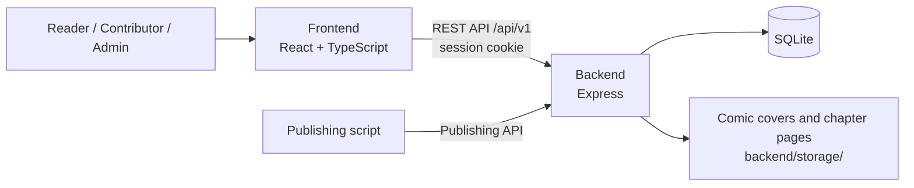

# Inkverse — A Comic Reading Platform

Inkverse is a website for discovering and reading manga, manhwa, and manhua. Readers can browse titles, read chapters, follow series, rate and discuss comics, and manage their reading history. Contributors publish through Studio or the Publishing API, while moderators and admins manage content through dedicated consoles.

## Web interface

<p align="center">
  
  
</p>

## System overview



| Area | Responsibility | Main technologies |
|---|---|---|
| [`frontend/`](frontend/) | Single-page web app for readers and the Studio/Admin consoles | React 19, TypeScript, Vite, React Router 7, CSS Modules |
| [`backend/`](backend/) | REST API, authentication, application logic, database, and uploaded image delivery | Node.js (ES modules), Express 4, Sequelize 6, SQLite |

## Features

- **Discover and read comics:** home page, search and filters, comic details, chapter reader, rankings, and recommendations.
- **Reader accounts:** profiles, follows, ratings, comments, reading history, and appearance preferences.
- **Studio:** contributors manage comics and chapters; moderators review submissions and reports; contributors can publish through the Publishing API.
- **Admin console:** manage users, content, role requests, comments, and application settings.
- **PWA support:** the frontend includes a web app manifest and service worker. API responses are not cached.

## Request flow

- The frontend uses the versioned REST API at `/api/v1`; interactive API documentation is available at `http://localhost:8083/api/docs` in Docker or `http://localhost:5000/api/docs` during local backend development.
- Browser sessions use an HttpOnly cookie, which the frontend sends with API requests.
- The backend stores application data in SQLite and serves uploaded images from `/storage/`.
- In Docker, Nginx serves the frontend and proxies `/api/` and `/storage/` to the backend on the private Compose network. The frontend uses same-origin requests; local Vite development defaults to `http://localhost:5000`.

## Project structure

### Backend

```text
backend/
├── src/
│   ├── config/        # Database connection configuration
│   ├── controllers/   # HTTP request and response handling
│   ├── docs/          # OpenAPI specification and Swagger UI
│   ├── helpers/       # Shared application helpers
│   ├── middlewares/   # Authentication, validation, errors, and uploads
│   ├── models/        # Sequelize models and table initialization
│   ├── repositories/  # Data access
│   ├── routes/        # API endpoint definitions
│   ├── services/      # Application logic
│   └── utils/         # Shared utilities
├── data/              # Default SQLite database
├── storage/           # Uploaded covers and chapter pages
├── scripts/           # Sample data and recommendation evaluation
└── tests/             # API and application tests
```

Requests are organized across the route → controller → service → repository layers. `src/server.js` starts the server, and `src/app.js` configures the Express application and middleware.

### Frontend

```text
frontend/
├── src/
│   ├── pages/         # Home, Browse, MangaDetail, MangaReader, Profile, Studio, Admin, and more
│   ├── components/    # Reusable UI components
│   ├── layout/        # Application and console layouts
│   ├── features/      # Studio and Admin feature modules
│   ├── console/       # Shared console UI and utilities
│   ├── services/      # Backend API client
│   ├── context/       # Authentication, theme, and toast state
│   ├── hooks/         # Shared React hooks
│   ├── helpers/       # Utility functions
│   ├── types/         # Shared TypeScript types
│   └── assets/        # UI assets
└── public/            # Manifest, service worker, icons, and static assets
```

## Run locally

Requirements: Node.js **20.19+** or **22.12+**, and npm.

Start the backend and frontend in separate terminals:

```bash
# Terminal 1 — backend at http://localhost:5000
cd backend
npm install
npm run dev
```

```bash
# Terminal 2 — frontend at http://localhost:5173
cd frontend
npm install
npm run dev
```

On first startup, the backend creates or updates the application tables in `backend/data/comic-platform.sqlite`. To recreate the database with empty tables and one admin account, stop the backend, set the admin credentials, and run the setup script in PowerShell:

```powershell
cd backend
$env:ADMIN_EMAIL = "admin@example.com"
$env:ADMIN_PASSWORD = "choose-a-strong-password"
node scripts/setupDatabase.js
```

The script asks you to type `RESET` before deleting the existing database. Pass `--yes` to confirm non-interactively. It creates all application tables but adds no sample comics or users; only the admin account is created. `ADMIN_USERNAME` defaults to `admin`; `ADMIN_DISPLAY_NAME` defaults to `Administrator`.

## Tests and build

```bash
# Backend tests
cd backend
npm test
```

```bash
# Type-check, lint, and build the frontend
cd frontend
npm run build
npm run lint
```

## Backend configuration

The backend reads configuration from environment variables. Development defaults are used when variables are not set.

Copy `.env.example` to `.env` for Docker Compose deployments. It lists the backend settings Compose passes through as well as monitoring and host-port settings. Update `CLIENT_ORIGIN` and `APP_URL` to the public frontend origin for production; use `COOKIE_SECURE=true` when serving over HTTPS. Keep SMTP credentials private.

| Variable | Default | Purpose |
|---|---|---|
| `PORT` | `5000` | Backend HTTP port when running outside Compose; Compose keeps the container port at `5000` |
| `CLIENT_ORIGIN` | `http://localhost:5173,http://127.0.0.1:5173` | Allowed frontend origins, separated by commas |
| `DB_PATH` | `backend/data/comic-platform.sqlite` locally; `/app/data/comic-platform.sqlite` in Compose | SQLite database path; use `:memory:` for an in-memory database |
| `STORAGE_ROOT` | `backend/storage` locally; `/app/storage` in Compose | Uploaded image directory |
| `APP_URL` | `http://localhost:5173` | Frontend URL used in password-reset emails |
| `COOKIE_SECURE`, `COOKIE_SAMESITE` | `false` for the local HTTP Compose deployment; `lax` | Session-cookie settings; set `COOKIE_SECURE=true` behind HTTPS; use `none` only for a cross-site frontend and HTTPS |
| `SMTP_HOST`, `SMTP_PORT`, `SMTP_USER`, `SMTP_PASS`, `MAIL_FROM` | SMTP disabled; port `587` | Optional email delivery; without `SMTP_HOST`, messages stay in the local outbox |
| `LOG_LEVEL` | `info` | Minimum backend log level |
| `REQUEST_TIMEOUT_MS` | `1800000` | Maximum request duration in milliseconds |
| `AUTH_RATE_LIMIT`, `COMIC_CREATE_RATE_LIMIT`, `SUGGEST_RATE_LIMIT` | `20`, `10`, `60` | Limits for authentication attempts, comic creation per hour, and suggestions per minute |
| `PUBLISH_BAD_KEY_LIMIT`, `PUBLISH_RATE_LIMIT`, `PUBLISH_BULK_RATE_LIMIT` | `20`, `60`, `10` | Publishing API limits for invalid keys, uploads, and bulk imports |
| `BULK_MAX_ARCHIVE_MB`, `BULK_MAX_ENTRIES`, `BULK_MAX_UNCOMPRESSED_MB` | `2048`, `20000`, `4096` | Bulk-import archive size and expansion limits |
| `NGINX_BIND_ADDRESS`, `NGINX_PORT` | `127.0.0.1`, `8083` | Host address and port for the Compose frontend/reverse proxy |
| `VITE_API_ORIGIN` | `/` | Frontend API origin at build time; `/` uses same-origin Nginx proxying |
| `GRAFANA_ADMIN_USER`, `GRAFANA_ADMIN_PASSWORD`, `GRAFANA_PORT` | `admin`, required, `3017` | Grafana login and host port; set a strong password |
| `APP_UID`, `APP_GID` | `1000`, `1000` | Linux host ownership IDs for mounted backend data and storage |

`ADMIN_EMAIL`, `ADMIN_PASSWORD`, `ADMIN_USERNAME`, and `ADMIN_DISPLAY_NAME` are used only by `backend/scripts/setupDatabase.js` when creating the initial admin account. Set them in the shell before running that script; they are not Compose runtime settings.

## Monitoring stack

The root Docker Compose file builds the frontend into an Nginx image and runs it with the backend, Prometheus, Grafana Alloy, Loki, and Grafana. Copy `.env.example` to `.env`, set a strong `GRAFANA_ADMIN_PASSWORD`, then start the stack:

```bash
docker compose up --build -d
```

Open the application at `http://localhost:8083` and Grafana at `http://localhost:3017`; sign in with the configured Grafana admin credentials. Nginx serves the SPA and reverse-proxies API and uploaded-file requests to the backend, which is not published to the host. Its JSON access logs are available through `docker compose logs nginx` and Docker's rotating local log driver. The provisioned **Comic App Overview** dashboard combines Prometheus request/Node.js process metrics with backend application, access, and audit logs from Loki. The SQLite database and uploaded files run in Docker; `backend/data/` and `backend/storage/` remain bind-mounted so existing local data is preserved. Prometheus, Loki, Grafana, and Alloy data use named volumes.

Prometheus and Loki are private to the Compose network; Nginx and Grafana bind to localhost by default. The default host ports `8083` and `3017` avoid common existing services on ports `80` and `3000`; override `NGINX_PORT` or `GRAFANA_PORT` if needed. For remote access, put a TLS-enabled reverse proxy with authentication in front of Nginx and set `APP_URL`, `CLIENT_ORIGIN`, and `COOKIE_SECURE=true` for the public origin. See [backend logging and monitoring conventions](backend/docs/api-conventions.md#8-logging) for retention, labels, permissions, and backup notes.

## Related documentation

- [Frontend README](frontend/README.md) — routes, PWA behavior, and frontend conventions.
- [API conventions](backend/docs/api-conventions.md) — authentication, versioning, HTTP status codes, and REST conventions.
- [Sequelize guide](backend/docs/orm-sequelize.md) — models, queries, and transactions.
- [Publishing API](backend/docs/publishing-api.md) — publish comics and chapters with scripts or bulk import.
- [OpenAPI source](backend/src/docs/openapi.yaml) — API specification.
- Swagger UI when the backend is running: <http://localhost:5000/api/docs>.
