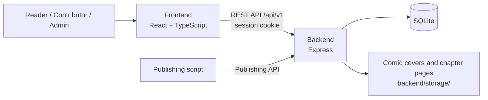

# Inkverse — A Comic Reading Platform

Inkverse is a website for discovering and reading manga, manhwa, and manhua. Readers can browse titles, read chapters, follow series, rate and discuss comics, and manage their reading history. Contributors publish through Studio or the Publishing API, while moderators and admins manage content through dedicated consoles.

## Web interface

<p align="center">
  
  
</p>

## System overview



| Area | Responsibility | Main technologies |
|---|---|---|
| [`frontend/`](frontend/) | Single-page web app for readers and the Studio/Admin consoles | React 19, TypeScript, Vite, React Router 7, CSS Modules |
| [`backend/`](backend/) | REST API, authentication, application logic, database, and uploaded image delivery | Node.js (ES modules), Express 4, Sequelize 6, SQLite |

## Features

- **Discover and read comics:** home page, search and filters, comic details, chapter reader, rankings, and recommendations.
- **Reader accounts:** profiles, follows, ratings, comments, reading history, and appearance preferences.
- **Studio:** contributors manage comics and chapters; moderators review submissions and reports; contributors can publish through the Publishing API.
- **Admin console:** manage users, content, role requests, comments, and application settings.
- **PWA support:** the frontend includes a web app manifest and service worker. API responses are not cached.

## Request flow

- The frontend uses the versioned REST API at `/api/v1`; interactive API documentation is available at `http://localhost:5000/api/docs`.
- Browser sessions use an HttpOnly cookie, which the frontend sends with API requests.
- The backend stores application data in SQLite and serves uploaded images from `/storage/`.
- The frontend API origin is currently set to `http://localhost:5000` in `frontend/src/services/api.ts`.

## Project structure

### Backend

```text
backend/
├── src/
│   ├── config/        # Database connection configuration
│   ├── controllers/   # HTTP request and response handling
│   ├── docs/          # OpenAPI specification and Swagger UI
│   ├── helpers/       # Shared application helpers
│   ├── middlewares/   # Authentication, validation, errors, and uploads
│   ├── models/        # Sequelize models and table initialization
│   ├── repositories/  # Data access
│   ├── routes/        # API endpoint definitions
│   ├── services/      # Application logic
│   └── utils/         # Shared utilities
├── data/              # Default SQLite database
├── storage/           # Uploaded covers and chapter pages
├── scripts/           # Sample data and recommendation evaluation
└── tests/             # API and application tests
```

Requests are organized across the route → controller → service → repository layers. `src/server.js` starts the server, and `src/app.js` configures the Express application and middleware.

### Frontend

```text
frontend/
├── src/
│   ├── pages/         # Home, Browse, MangaDetail, MangaReader, Profile, Studio, Admin, and more
│   ├── components/    # Reusable UI components
│   ├── layout/        # Application and console layouts
│   ├── features/      # Studio and Admin feature modules
│   ├── console/       # Shared console UI and utilities
│   ├── services/      # Backend API client
│   ├── context/       # Authentication, theme, and toast state
│   ├── hooks/         # Shared React hooks
│   ├── helpers/       # Utility functions
│   ├── types/         # Shared TypeScript types
│   └── assets/        # UI assets
└── public/            # Manifest, service worker, icons, and static assets
```

## Run locally

Requirements: Node.js **20.19+** or **22.12+**, and npm.

Start the backend and frontend in separate terminals:

```bash
# Terminal 1 — backend at http://localhost:5000
cd backend
npm install
npm run dev
```

```bash
# Terminal 2 — frontend at http://localhost:5173
cd frontend
npm install
npm run dev
```

On first startup, the backend creates or updates the application tables in `backend/data/comic-platform.sqlite`. To load sample data:

```bash
cd backend
node scripts/seed.js
```

> **Warning:** The seed script deletes existing data before creating the sample dataset. Do not run it if you need to preserve the current database contents.

## Tests and build

```bash
# Backend tests
cd backend
npm test
```

```bash
# Type-check, lint, and build the frontend
cd frontend
npm run build
npm run lint
```

## Backend configuration

The backend reads configuration from environment variables. Development defaults are used when variables are not set.

| Variable | Default | Purpose |
|---|---|---|
| `PORT` | `5000` | Backend HTTP port |
| `CLIENT_ORIGIN` | `http://localhost:5173,http://127.0.0.1:5173` | Allowed frontend origins, separated by commas |
| `DB_PATH` | `backend/data/comic-platform.sqlite` | SQLite database path; use `:memory:` for an in-memory database |
| `STORAGE_ROOT` | `backend/storage` | Uploaded image directory |
| `APP_URL` | `http://localhost:5173` | Frontend URL used in password reset emails |
| `SMTP_HOST`, `SMTP_PORT`, `SMTP_USER`, `SMTP_PASS`, `MAIL_FROM` | — | Email configuration; messages are logged to the console when SMTP is not configured |

## Related documentation

- [Frontend README](frontend/README.md) — routes, PWA behavior, and frontend conventions.
- [API conventions](backend/docs/api-conventions.md) — authentication, versioning, HTTP status codes, and REST conventions.
- [Sequelize guide](backend/docs/orm-sequelize.md) — models, queries, and transactions.
- [Publishing API](backend/docs/publishing-api.md) — publish comics and chapters with scripts or bulk import.
- [OpenAPI source](backend/src/docs/openapi.yaml) — API specification.
- Swagger UI when the backend is running: <http://localhost:5000/api/docs>.
