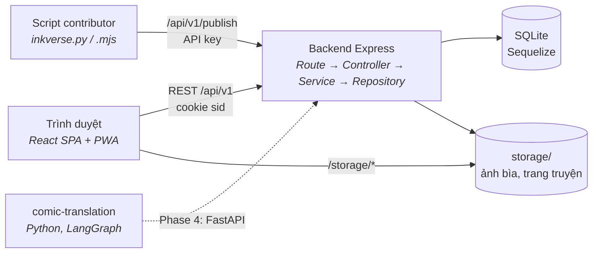

# Tổng kết kỹ thuật, kiến trúc và tiêu chuẩn

Những gì dự án Inkverse đang dùng, **dùng ở đâu** và **vì sao**. Phần dịch truyện có bản tổng kết riêng:
[comic-translation/TECHNIQUES.md](comic-translation/TECHNIQUES.md).

## Mục lục

1. [Kiến trúc tổng thể](#1-kiến-trúc-tổng-thể)
2. [Backend: kiến trúc và pattern](#2-backend-kiến-trúc-và-pattern)
3. [Thiết kế API](#3-thiết-kế-api)
4. [Dữ liệu và truy vấn](#4-dữ-liệu-và-truy-vấn)
5. [Bảo mật](#5-bảo-mật)
6. [Thuật toán: xếp hạng, tìm kiếm, gợi ý](#6-thuật-toán-xếp-hạng-tìm-kiếm-gợi-ý)
7. [Frontend](#7-frontend)
8. [Kiểm thử và chất lượng](#8-kiểm-thử-và-chất-lượng)
9. [Tiêu chuẩn đã áp dụng](#9-tiêu-chuẩn-đã-áp-dụng)
10. [Thư viện](#10-thư-viện)

---

## 1. Kiến trúc tổng thể

- **Client–server, tách frontend/backend**: hai ứng dụng độc lập trong một repo (monorepo), giao tiếp qua REST + JSON.
- **Backend nhiều tầng (layered architecture)**, mỗi tầng một trách nhiệm (mục 2).
- **Frontend là SPA**, với hai "console" (Studio, Admin) dựng trên cùng một khung module (mục 7).
- **Hai cách xác thực cho hai loại client**: cookie phiên cho trình duyệt, API key cho script.

## 2. Backend: kiến trúc và pattern

| Kỹ thuật | Áp dụng | Ở đâu |
|---|---|---|
| **Layered architecture** | `Route` (URL + middleware) → `Controller` (HTTP) → `Service` (nghiệp vụ, quyền, transaction) → `Repository` (truy vấn) → `Model` | `backend/src/*` |
| **Repository pattern** | Service không biết SQL/ORM; đổi DB chỉ sửa repository | `repositories/` |
| **Middleware chain** | xác thực, phân quyền, CSRF, rate limit, upload, kiểm tra ảnh, xử lý lỗi | `middlewares/` |
| **Centralized error handling** | Service `throw new NotFoundError(...)` (lỗi mang sẵn status) → `asyncHandler` → `errorMiddleware` | `errors.js`, `utils/asyncHandler.js` |
| **Factory function** | `listComments('comic')`, `listContributors('chapter')`: một handler phục vụ nhiều loại tài nguyên | controllers |
| **DRY bằng bảng tra** | Comment truyện và chapter dùng chung repository qua bảng `TARGETS` | `commentRepository.js` |
| **Policy tập trung** | `isStaff`, `canManageComic`, `READABLE` | `services/permissions.js`, `repositories/visibility.js` |
| **Tách `app` khỏi `server`** | `app.js` tạo app (supertest dùng), `server.js` chỉ `listen` | `src/app.js`, `src/server.js` |
| **Cấu hình qua biến môi trường** | DB, storage, rate limit, cookie, SMTP (12-factor) | xem [README](README.md#4-biến-môi-trường) |
| **Cache trong bộ nhớ có TTL** | kết quả gợi ý (15 phút / user), vector truyện; xoá khi user tương tác | `recommendationService.js` |

## 3. Thiết kế API

Chi tiết: [backend/docs/api-conventions.md](backend/docs/api-conventions.md).

| Kỹ thuật | Áp dụng |
|---|---|
| **REST, resource-oriented** | danh từ số nhiều, lồng tối đa một cấp, `/me` cho dữ liệu của người đang đăng nhập |
| **URI versioning** | `/api/v1`; v2 sẽ chạy song song |
| **Ngữ nghĩa HTTP method** | `PUT` idempotent cho trạng thái (follow, rating, reaction, block), `PATCH` sửa một phần, `DELETE` idempotent |
| **Status code chuẩn** | `201` + header `Location`, `204` không body, `404` thay `403` để không lộ tài nguyên |
| **Problem Details (RFC 9457)** | mọi lỗi là `application/problem+json` |
| **Phân trang offset** + `meta` | `page`, `pageSize` (có giới hạn), `totalItems`, `totalPages`; khoá sắp xếp phụ `id` cho thứ tự ổn định |
| **Sort/filter whitelist** | `sort=-rating,name`; giá trị sai → 400, không tự sửa |
| **OpenAPI 3.1, design-first** | `src/docs/openapi.yaml`, Swagger UI tại `/api/docs` |
| **Contract test** | test đỏ nếu route và spec lệch nhau (`tests/conventions.test.js`) |
| **Rate limit có header chuẩn** | header `RateLimit` (IETF draft-7), `Retry-After` cho script |

## 4. Dữ liệu và truy vấn

| Kỹ thuật | Áp dụng | Ở đâu |
|---|---|---|
| **ORM Sequelize** + SQL thô khi rõ hơn | truy vấn thường qua model; báo cáo phức tạp qua `select()` có placeholder | [orm-sequelize.md](backend/docs/orm-sequelize.md) |
| **Transaction tự lan truyền** | `AsyncLocalStorage` + `Sequelize.useCLS`: không cần truyền `{ transaction }` | `config/database.js` |
| **Xếp hàng transaction + `BEGIN IMMEDIATE`** | SQLite chỉ có một writer: giữ khoá ghi từ đầu, tự thử lại khi `SQLITE_BUSY` | `config/database.js` |
| **Chống race condition check-then-act** | kiểm tra trùng nằm trong transaction | services |
| **Recursive CTE** | dựng cây comment trong một truy vấn | `commentRepository.js` |
| **Tránh N+1 query** | lấy genres / chapter mới nhất cho cả danh sách bằng `IN (...)` rồi gom nhóm | `comicService.withGenresAndLatestChapters` |
| **Trigger SQLite** | giữ cột `searchText` (bỏ dấu) luôn đúng với mọi đường ghi | `models/searchText.js` |
| **Denormalized counter** | `comics.view`, `follow`, `rating`, like/dislike, cập nhật trong cùng transaction; `MAX(x + ?, 0)` chống âm | repositories |
| **Upsert** | `INSERT ... ON CONFLICT DO UPDATE` cho lượt xem theo ngày, rating, lịch sử đọc | `viewRepository.js`, ... |
| **Soft delete** | comment, truyện, chapter dùng `deletedAt` | models |
| **Schema evolution nhẹ** | `sync()` tạo bảng thiếu + `addColumnIfMissing` cho cột mới | `models/index.js` |

## 5. Bảo mật

Chi tiết: [backend/docs/security-and-bugfix-changes.md](backend/docs/security-and-bugfix-changes.md).

| Mối đe doạ (OWASP Top 10) | Biện pháp |
|---|---|
| Lộ mật khẩu | **bcrypt** (10 rounds), giới hạn 72 byte; tự nâng cấp mật khẩu cũ khi đăng nhập |
| Đánh cắp phiên qua XSS | token trong **cookie HttpOnly**, `SameSite=Lax`, `Secure` ở production |
| **CSRF** | kiểm tra `Origin`/`Referer` cho request ghi dữ liệu |
| Brute force | **rate limit** đăng nhập/đăng ký/đặt lại mật khẩu, key API sai, upload |
| Broken access control | `requireRole` ở route + kiểm tra quyền sở hữu ở service + `READABLE` cho nội dung |
| Stored XSS qua upload | whitelist MIME (không SVG), tên file UUID, **magic bytes**, `nosniff` |
| Zip slip / zip bomb | kiểm tra đường dẫn, số entry, dung lượng trước khi giải nén |
| Lộ thông tin | che lỗi ≥ 500, ẩn `X-Powered-By`, **helmet**, `404` thay `403` |
| SQL injection | placeholder, tên bảng chỉ từ bảng tra trong code, whitelist cột sắp xếp |
| Token đặt lại mật khẩu / API key | chỉ lưu **SHA-256**, so sánh **constant-time** (`timingSafeEqual`), có hạn, thu hồi được, có scope |
| Dò tài khoản | quên mật khẩu luôn trả `204` |

## 6. Thuật toán: xếp hạng, tìm kiếm, gợi ý

Chi tiết: [FEATURES-PLAN.md](FEATURES-PLAN.md) (Phase 1–3).

| Bài toán | Kỹ thuật |
|---|---|
| Đếm lượt xem | gom theo ngày (time bucket `comic_daily_views`); chống F5 bằng cửa sổ 30 phút |
| Bảng xếp hạng | điểm có trọng số `views + 5·follow mới + 3·rating mới` theo ngày/tuần/tháng |
| Tìm không dấu | **accent folding** (bỏ dấu tiếng Việt, chữ thường) lưu sẵn trong cột + trigger; `LIKE ... ESCAPE` |
| Gợi ý khi gõ | xếp hạng khớp chính xác → tiền tố → độ phổ biến; client debounce 250 ms + huỷ request cũ |
| **Content-based Filtering** | vector đặc trưng one-hot (genre, format, demographic, type), trọng số **IDF**, chuẩn hoá L2, **cosine similarity**, hồ sơ người dùng có trừ truyện không thích |
| **User-based Collaborative Filtering** | **implicit feedback** (follow, chapter đã đọc, rating), cosine giữa người dùng, **significance weighting**, K láng giềng gần nhất (K = 30) |
| **Hybrid** | trộn tuyến tính `α·cf + (1−α)·cb`, α tăng theo số láng giềng; **cold start** dùng trending |
| Đa dạng hoá | re-rank tham lam, không quá 3 truyện liền cùng genre |
| Đánh giá | **offline evaluation**: giấu 20% tương tác, đo **Precision@10 / Recall@10**, so với baseline Popularity |

## 7. Frontend

Chi tiết: [frontend/README.md](frontend/README.md).

| Kỹ thuật | Áp dụng |
|---|---|
| **React 19 + TypeScript** | component hàm + hooks; kiểu dùng chung trong `types/types.ts` |
| **Vite** | dev server có HMR, build ES2023 |
| **Client-side routing** | React Router 7, route lồng nhau, `ProtectedRoute` theo role |
| **Code splitting** | mỗi module Studio/Admin là `React.lazy`; `fflate` tải bằng `import()` động |
| **Plugin-style console** | thêm tính năng = thêm một mục vào `modules.ts` (quyền, menu, badge, component) |
| **State management bằng Context** | `AuthContext`, `ThemeContext`, `ToastContext`; trạng thái bộ lọc nằm trên **URL** (`useQueryState`) |
| **API layer tập trung** | `services/api.ts`: cookie `credentials: 'include'`, chuyển lỗi RFC 9457 thành `ApiError`, sự kiện `auth-expired` |
| **CSS Modules** | style riêng từng component, theme bằng biến CSS |
| **PWA** | manifest + service worker: network-first cho trang, cache-first cho asset và ảnh truyện (giới hạn 400 ảnh) → đọc offline chapter đã xem |
| **UX tìm kiếm** | debounce, `AbortController`, điều khiển bằng bàn phím |
| **Tối ưu bundle** | ~1.9k ảnh emoji không inline vào JS (`assetsInlineLimit`) |

## 8. Kiểm thử và chất lượng

| Kỹ thuật | Áp dụng |
|---|---|
| **Integration test API** | Vitest + supertest gọi thẳng `app` (không mở cổng), 146 test / 19 file |
| **DB cô lập cho test** | SQLite `:memory:` riêng mỗi file test, thư mục storage tạm |
| **Test trước khi refactor** | khoá hành vi bằng test rồi mới tách tầng ([instruction.md](backend/instruction.md)) |
| **Parameterized test** | `describe.each(['comics','chapters'])` cho hai loại comment |
| **Unit test hàm thuần** | thuật toán gợi ý là hàm thuần trên `Map`, test riêng không cần DB |
| **Contract test** | OpenAPI hợp lệ và khớp route |
| Kiểm tra tĩnh frontend | `tsc -b` (`noUnusedLocals`, `noUnusedParameters`), **oxlint** |
| Quy ước commit | dạng Conventional Commits: `feat(scope): ...`, `fix(...)`, `chore: ...` |

## 9. Tiêu chuẩn đã áp dụng

| Tiêu chuẩn | Dùng cho |
|---|---|
| **RFC 9110** (HTTP Semantics) | method, status code, idempotency, `Location` |
| **RFC 9457** (Problem Details) | định dạng lỗi |
| **OpenAPI 3.1** | tài liệu API |
| **RFC 6265** + `SameSite` | cookie phiên |
| **CORS** (Fetch Standard) | origin được phép, `credentials`, `exposedHeaders: Location` |
| IETF draft *RateLimit header fields* (draft-7), `Retry-After` | báo giới hạn cho client |
| **OWASP** (Top 10, CSRF Prevention Cheat Sheet) | thiết kế bảo mật |
| **ECMAScript Modules** | `"type": "module"` ở cả backend và frontend |
| **ISO 8601 / UTC** | thời gian trong API (`expiresAt`, `createdAt`); DB lưu text UTC |
| **UTF-8, Unicode** | dữ liệu tiếng Việt; bỏ dấu cả dạng NFD |
| **Web App Manifest, Service Worker** | PWA |
| **Semantic Versioning** | phiên bản package |

## 10. Thư viện

| Backend | Vai trò | Frontend | Vai trò |
|---|---|---|---|
| express | HTTP server | react, react-dom | UI |
| sequelize, sqlite3 | ORM, CSDL | react-router-dom | điều hướng |
| bcryptjs | hash mật khẩu | lucide-react | icon |
| helmet, cors, cookie-parser | header bảo mật, CORS, đọc cookie | fflate | nén zip trong trình duyệt |
| express-rate-limit | giới hạn tần suất | vite, typescript | build, kiểm tra kiểu |
| multer | nhận file multipart | oxlint | lint |
| yauzl / yazl | đọc zip (nhập hàng loạt) / tạo zip trong test | | |
| nodemailer | gửi email đặt lại mật khẩu | | |
| swagger-ui-express, yaml | hiển thị OpenAPI | | |
| vitest, supertest, @apidevtools/swagger-parser | test, kiểm tra spec | | |
