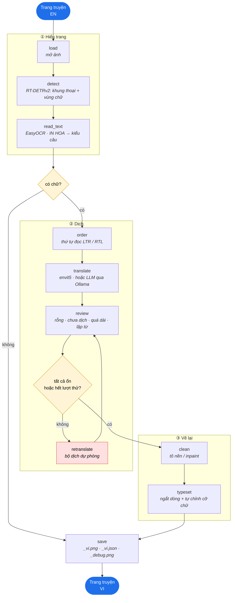
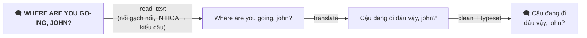

# Comic Translation (EN → VI) — Kế hoạch

## Mục tiêu và ràng buộc

- **Mục tiêu:** dịch trang truyện tranh tiếng Anh sang tiếng Việt và chèn bản dịch lại lên trang.
  Ưu tiên chữ trong khung thoại trước, chữ tự do (caption, biển hiệu) sau.
- **Tích hợp:** về sau gắn vào backend Node (trang `ChapterImage`) qua một service HTTP (Phase 4).
- **Phần cứng:** GPU máy local là GTX 1650 Ti (4 GB VRAM) → chỉ chạy suy luận với model nhỏ đã huấn luyện sẵn;
  nếu fine-tune thì làm trên Colab/Kaggle.

## Pipeline

Điều phối bằng LangGraph `StateGraph` (`src/comic_translator/graph/`):

Vòng `review → retranslate` chỉ chạy khi có `--fallback`, và tối đa `max_retries` lần (mặc định 1).
Câu vẫn sai sau đó được giữ nguyên `issue` và liệt kê trong `needs_review` của file `_vi.json`.

### Ví dụ một khung thoại

OCR đọc ra hai dòng `WHERE ARE YOU GO-` và `ING, JOHN?`:

Chú ý `JOHN` thành `john`: bước chuyển kiểu câu chưa nhận biết tên riêng (việc của Phase 2).

### Model cho từng bước

| Bước | Hiện dùng | Hướng nâng cấp |
|---|---|---|
| Detect | `ogkalu/comic-text-and-bubble-detector` (RT-DETRv2, Apache-2.0) | comic-text-detector |
| OCR | EasyOCR (`english_g2`) | PaddleOCR / Florence-2 |
| Dịch | `VietAI/envit5-translation` (T5, OpenRAIL) | LLM qua Ollama (mặc định `qwen2.5:3b`; thử Qwen3-4B lượng tử Q4) với ngữ cảnh trang + glossary |
| Xoá chữ | tô màu trung vị của viền (khung thoại phẳng), OpenCV inpaint Telea (còn lại) | LaMa |
| Chèn chữ | Pillow, tìm nhị phân cỡ chữ | font truyện tranh có dấu tiếng Việt trong `assets/fonts/` |

Tránh NLLB-200 nếu app có thể dùng thương mại (giấy phép CC-BY-NC).

## Các phase

| | Phase | Nội dung | Trạng thái |
|---|---|---|---|
| ✅ | **0 Khởi tạo** | package src-layout, pipeline LangGraph, CLI, test không cần model | xong |
| ✅ | **1 MVP khung thoại** | detect → OCR → dịch → tô nền → chèn chữ | code xong, **chưa chạy trên trang thật** |
| ✅ | **2a Vòng review** | kiểm tra theo luật + dịch lại bằng bộ dịch dự phòng (node trong graph) | xong |
| ⬜ | **2 Chất lượng** | thứ tự đọc theo panel, đại từ nhất quán, giữ hoa tên riêng, glossary cho envit5, xử lý tràn chữ | |
| ⬜ | **3 Chữ tự do** | inpaint LaMa, chữ xoay, tuỳ chọn dịch SFX (bản cơ bản đã có sau `--free-text`) | |
| ⬜ | **4 Service** | FastAPI (`POST /translate/page`, `/translate/chapter`); backend Node lưu trang VI | |
| ⬜ | **5 Fine-tune** *(tuỳ chọn)* | envit5/Marian trên PhoMT + phụ đề EN-VI + các cặp `*_vi.json` đã sửa tay | |

**Việc kế tiếp:** đặt 20–50 trang thật vào `data/samples/`, chạy `--debug` và đo theo mục dưới.

## Đánh giá

Dùng một bộ cố định 20–50 trang trong `data/samples/`:

| Tiêu chí | Cách đo |
|---|---|
| Recall khung thoại | số khung thoại tìm được / tổng số khung thoại (đếm tay trên ảnh `_debug.png`) |
| Chất lượng OCR | CER (character error rate) so với chữ gõ tay |
| Chất lượng dịch | người đọc chấm từng câu; theo dõi số câu trong `needs_review` |
| Kết quả hình ảnh | so sánh trước/sau: chữ cũ có sót không, chữ mới có tràn/khó đọc không |
