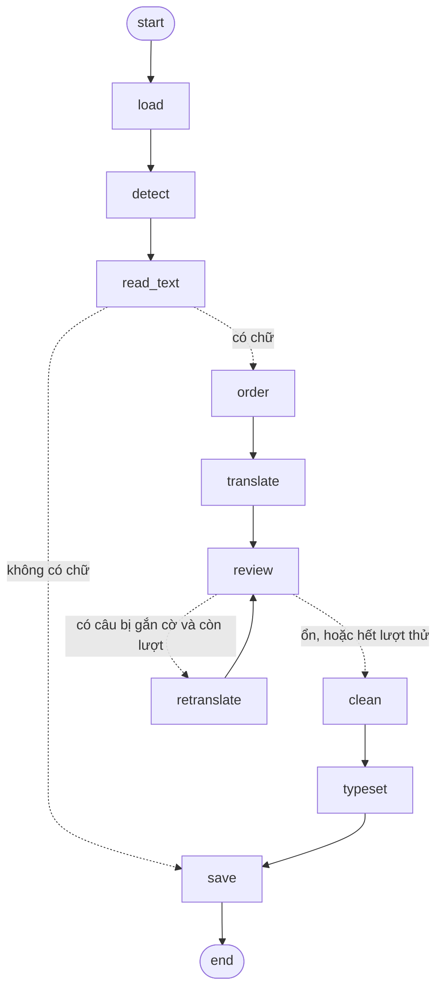

# Comic Translator (EN → VI)

Dịch trang truyện tranh tiếng Anh sang tiếng Việt: tìm khung thoại, đọc chữ (OCR), dịch,
xoá chữ gốc rồi chèn bản dịch vào đúng khung thoại. Pipeline là một **LangGraph `StateGraph`**:
mỗi bước là một node, và có một vòng *review* tự dịch lại những câu dịch đáng ngờ.

> **Trạng thái:** Phase 0–1 và 2a đã viết xong, 18 test (không dùng model) đều qua.
> Chưa chạy với model thật trên trang truyện thật. Lộ trình: [PLAN.md](PLAN.md).
> Kỹ thuật và kiến trúc đã dùng: [TECHNIQUES.md](TECHNIQUES.md).

## Mục lục

1. [Pipeline](#1-pipeline)
2. [Cài đặt](#2-cài-đặt)
3. [Sử dụng (CLI)](#3-sử-dụng-cli)
4. [Dùng từ Python](#4-dùng-từ-python)
5. [Kết quả đầu ra](#5-kết-quả-đầu-ra)
6. [Cấu trúc thư mục](#6-cấu-trúc-thư-mục)
7. [Test](#7-test)
8. [Giới hạn hiện tại](#8-giới-hạn-hiện-tại)

---

## 1. Pipeline



Nét đứt là *conditional edge* (rẽ nhánh theo state). In sơ đồ thật từ code: `comic-translate --show-graph`.

| Node | Việc làm | Code |
|---|---|---|
| `load` | mở ảnh từ đường dẫn, hoặc nhận ảnh đã có trong bộ nhớ; chuyển sang RGB | `graph/nodes.py` |
| `detect` | RT-DETRv2 tìm khung thoại + vùng chữ, gắn mỗi vùng chữ vào khung thoại chứa nó | `models/detector.py`, `processing/regions.py` |
| `read_text` | EasyOCR từng vùng; chữ IN HOA → chữ thường kiểu câu; bỏ vùng không có chữ cái và tiếng động (SFX) ngoài khung thoại | `models/ocr.py`, `processing/text.py` |
| `order` | sắp thứ tự đọc: trái → phải (hoặc phải → trái cho manga với `--rtl`) | `processing/regions.py` |
| `translate` | dịch cả trang trong một lần gọi: envit5 (mặc định) hoặc LLM qua Ollama | `models/translator.py` |
| `review` | gắn cờ câu dịch rỗng / chưa dịch / dài bất thường / lặp từ | `processing/review.py` |
| `retranslate` | gửi các câu bị gắn cờ cho bộ dịch dự phòng (`--fallback`) | `models/translator.py` |
| `clean` | xoá chữ tiếng Anh: tô màu nền nếu khung thoại phẳng màu, còn lại thì inpaint | `processing/cleaning.py` |
| `typeset` | ngắt dòng + tự chọn cỡ chữ lớn nhất vừa khung, vẽ chữ tiếng Việt | `processing/typesetting.py` |
| `save` | ghi `<tên>_vi.png`, `<tên>_vi.json` (và `<tên>_debug.png` nếu có `--debug`) | `graph/nodes.py` |

Ví dụ một khung thoại đi qua pipeline: xem [PLAN.md](PLAN.md#ví-dụ-một-khung-thoại).

## 2. Cài đặt

Yêu cầu: Python ≥ 3.10. GPU NVIDIA không bắt buộc (không có thì chạy CPU, chậm hơn).

```powershell
cd comic-translation
python -m venv .venv
.venv\Scripts\Activate.ps1            # Git Bash: source .venv/Scripts/activate

# 1) PyTorch bản CUDA. Chọn cu126 / cu128 / cu130 theo driver (xem `nvidia-smi`);
#    cu130 cần driver NVIDIA ≥ 580. Bỏ --index-url nếu chỉ chạy CPU.
pip install torch torchvision --index-url https://download.pytorch.org/whl/cu130

# 2) Package này (chế độ editable) + pytest
pip install -e ".[dev]"
```

Lần chạy đầu tiên sẽ tự tải model:

| Model | Nguồn | Dùng cho |
|---|---|---|
| `ogkalu/comic-text-and-bubble-detector` | Hugging Face | `detect` |
| `VietAI/envit5-translation` | Hugging Face | `translate` (mặc định) |
| EasyOCR `english_g2` | GitHub release của EasyOCR (lưu ở `~/.EasyOCR/`) | `read_text` |

Muốn dịch bằng LLM: cài [Ollama](https://ollama.com), rồi `ollama pull qwen2.5:3b` (model mặc định).

## 3. Sử dụng (CLI)

```bash
comic-translate data/samples/page01.png -o outputs --debug   # một trang, kèm ảnh debug
comic-translate data/samples -o outputs                      # cả thư mục (.png .jpg .jpeg .webp)
comic-translate data/samples --fallback ollama               # LLM dịch lại câu bị gắn cờ
comic-translate data/samples --translator ollama --glossary glossary.json
comic-translate data/samples --free-text                     # dịch cả chữ ngoài khung thoại (bản cơ bản)
comic-translate --show-graph                                 # in pipeline dạng Mermaid rồi thoát
```

`python -m comic_translator ...` tương đương `comic-translate ...`.

| Tuỳ chọn | Mặc định | Ý nghĩa |
|---|---|---|
| `input` | — | file ảnh hoặc thư mục ảnh |
| `-o, --out` | `outputs` | thư mục ghi kết quả |
| `--translator {envit5,ollama}` | `envit5` | bộ dịch chính |
| `--fallback {envit5,ollama}` | tắt | bộ dịch dự phòng cho vòng review; không đặt thì không dịch lại |
| `--ollama-model` | `qwen2.5:3b` | model Ollama |
| `--glossary FILE` | — | JSON `{"tên tiếng Anh": "tiếng Việt"}`; **chỉ bộ dịch Ollama dùng**, envit5 bỏ qua |
| `--free-text` | tắt | xử lý cả chữ ngoài khung thoại (caption, biển hiệu) |
| `--translate-sfx` | tắt | không bỏ qua tiếng động (BOOM!, KRAKK) ngoài khung thoại |
| `--rtl` | tắt | thứ tự đọc phải → trái (manga) |
| `--uppercase` | tắt | chèn bản dịch bằng chữ IN HOA |
| `--font FILE` | xem [assets/fonts](assets/fonts/README.md) | font `.ttf`/`.otf` có dấu tiếng Việt |
| `--device {auto,cuda,cpu}` | `auto` | thiết bị chạy model |
| `--debug` | tắt | ghi thêm ảnh khoanh các vùng phát hiện được |

Mã thoát: `0` thành công, `1` không tìm thấy ảnh, `2` thiếu tham số `input`.

## 4. Dùng từ Python

Truyền ảnh trong bộ nhớ và không đặt `output_dir` → không ghi gì ra đĩa (dùng cho API sau này):

```python
from PIL import Image
from comic_translator import Config, build_graph

graph = build_graph(Config(translator="envit5"))   # model chỉ được tải khi dùng lần đầu
state = graph.invoke({"image": Image.open("page01.png")})

state["rendered"]   # PIL.Image đã dịch
state["regions"]    # list[TextRegion]: box, text, source, translation, issue, order, ...
```

Muốn ghi file thì truyền thêm `"image_path"` và `"output_dir"` như CLI.

## 5. Kết quả đầu ra

Với `page01.png` và `-o outputs`:

| File | Nội dung |
|---|---|
| `outputs/page01_vi.png` | trang đã dịch (trang không có chữ thì là bản sao trang gốc) |
| `outputs/page01_vi.json` | chi tiết từng vùng chữ, dùng để soát lỗi hoặc làm dữ liệu fine-tune |
| `outputs/page01_debug.png` | chỉ khi `--debug`: khung thoại xanh lá, chữ trong khung xanh dương, chữ ngoài khung cam, câu bị gắn cờ đỏ; số là thứ tự đọc |

Cấu trúc `_vi.json`:

```json
{
  "source": "data/samples/page01.png",
  "size": [800, 1200],
  "needs_review": [3],
  "regions": [
    {
      "box": [60, 70, 240, 130],
      "kind": "bubble",
      "bubble_box": [20, 20, 280, 180],
      "text": "WHERE ARE YOU GOING?",
      "source": "Where are you going?",
      "translation": "Cậu đang đi đâu vậy?",
      "issue": null,
      "order": 0,
      "...": "score, ocr_conf, lines, bg_color"
    }
  ]
}
```

- `text`: chữ OCR đọc được; `source`: chữ đã chuẩn hoá, là thứ thực sự gửi đi dịch.
- `issue`: lý do bị gắn cờ (`empty`, `untranslated`, `too_long`, `repetition`) nếu vẫn sai sau vòng review.
- `needs_review`: giá trị `order` của các vùng còn `issue` → cần người xem lại. CLI cũng in số câu này.

## 6. Cấu trúc thư mục

```
comic-translation/
├── src/comic_translator/
│   ├── cli.py              # lệnh `comic-translate`
│   ├── __main__.py         # cho phép `python -m comic_translator`
│   ├── config.py           # toàn bộ cấu hình trong một dataclass
│   ├── schemas.py          # Detection, TextRegion, các hàm xử lý box
│   ├── services.py         # model nạp lười (lazy), dùng chung cho các node
│   ├── graph/              # LangGraph: state.py, nodes.py, builder.py
│   ├── models/             # bọc model ML: detector, OCR, translator
│   └── processing/         # logic thuần, không cần model: regions, text, review,
│                           #   cleaning, typesetting, visualize
├── tests/                  # test không cần model (fakes.py thay thế model)
├── assets/fonts/           # đặt font tiếng Việt ở đây (git-ignored, trừ README)
├── data/samples/           # trang truyện để thử (git-ignored)
└── outputs/                # kết quả, tạo khi chạy (git-ignored)
```

## 7. Test

```bash
python -m pytest
```

Test dùng model giả trong `tests/fakes.py` nên chạy được khi chưa tải model, không cần GPU.
Bao phủ: luồng graph (dịch + ghi file, không ghi file khi chạy trong bộ nhớ, trang không có chữ,
vòng review và giới hạn số lần thử), xử lý vùng, chuẩn hoá chữ, xoá chữ và typeset.

## 8. Giới hạn hiện tại

- **Tên riêng bị viết thường:** chữ IN HOA được chuyển sang kiểu câu, nên `JOHN` → `john`.
  Sẽ xử lý ở Phase 2 (glossary/nhận diện tên riêng).
- **Thứ tự đọc** chỉ theo hàng ngang, chưa nhận biết khung tranh (panel).
- **envit5 dịch từng câu riêng lẻ**: không có ngữ cảnh trang, không dùng glossary, đại từ
  (tôi/cậu/anh/em...) có thể không nhất quán. Bộ dịch Ollama xử lý tốt hơn nhưng chậm hơn.
- **Tràn chữ:** nếu bản dịch không vừa khung ở cỡ chữ nhỏ nhất (10px), chữ vẫn được vẽ và có thể tràn.
- **Inpaint** dùng OpenCV (Telea) nên nền phức tạp sẽ bị nhoè; LaMa dự kiến ở Phase 3.
- `--fallback` trùng với `--translator` thì vòng review gần như vô ích (cùng model, cùng kết quả).
